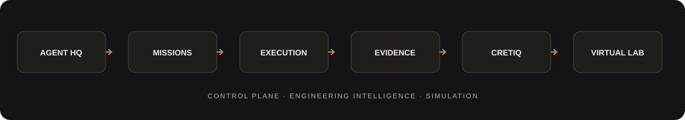

 

**CIVIL ENGINEER · CONCRETE QUALITY CONTROL · ENGINEERING SOFTWARE · AGENTIC AI**

*Engineering first. Intelligence second.*

---

## Mohammadreza Azarmi

I'm a civil engineer and concrete quality-control practitioner building practical software where **engineering rules, traceable evidence, real data, and controlled automation** meet.

I work across concrete QC and laboratory workflows, interactive engineering education, AI-agent infrastructure, and product interfaces. I care about making complex systems genuinely useful—not just visually impressive.

> **AI accelerates the work. Evidence remains the source of truth.**

## Flagship systems

| System | Purpose | Current visibility |
|---|---|---|
| [**Cretiq**](https://github.com/azarmi8/cretiq) | Concrete engineering intelligence: QC, laboratory, standards, analytics, environmental data, traceability and governed AI | 🔒 Private · Active development |
| [**Agent HQ**](https://github.com/azarmi8/agent-hq) | Governed operations control plane for AI-agent missions, execution evidence, training, R&D and human-reviewed delivery | 🔒 Private · Active development |
| [**Virtual Concrete Lab**](https://github.com/azarmi8/virtual-concrete-lab) | Interactive education through simulated concrete/materials tests, equipment, procedures and reports | 🔒 Private · Prototype / first milestone |
| [**CRETIQ 6044**](https://github.com/azarmi8/standard-6044-interactive) | Interactive Persian learning and assessment environment for Iranian National Standard 6044:1397 | 🌐 Public · Release validation ongoing |

## Project portfolio

### Concrete engineering and laboratory tools

| Project | What it does | Status |
|---|---|---|
| [Cretiq](https://github.com/azarmi8/cretiq) | A quality and engineering platform connecting samples, test series, specimens, results, standards, audit trails and factory operations | 🔒 Private · In development |
| [Virtual Concrete Lab](https://github.com/azarmi8/virtual-concrete-lab) | A procedural testing simulator; simulated readings are educational and must never be mistaken for real laboratory results | 🔒 Private · Prototype |
| [CRETIQ 6044](https://github.com/azarmi8/standard-6044-interactive) | Web-based study, interactive scenarios, simulations and assessment for concrete standard 6044:1397 | 🌐 Public |
| [BetonBazBot](https://github.com/azarmi8/BetonBazBot) | AI-assisted workflows for concrete and construction engineering, with human verification | 🌐 Public · Capability follows current source |
| [BetonBaz API](https://github.com/azarmi8/betonbaz-api) | Backend/API infrastructure for engineering applications and structured domain data | 🌐 Public · Supporting infrastructure |
| [Lab Automation](https://github.com/azarmi8/lab-automation) | Converts Persian handwritten concrete-lab forms into structured data and Excel output; extracted values still require engineering review | 🔒 Private · Utility tool |
| [OpenMausBot Skills](https://github.com/azarmi8/openmausbot-skills) | Reusable domain skills for task decomposition, coordination, concrete unit conversion, data cleaning, quality checks, statistics and reporting | 🌐 Public · Skill library |

### AI systems and web intelligence

| Project | What it does | Status |
|---|---|---|
| [Agent HQ](https://github.com/azarmi8/agent-hq) | Cloud-first control plane for bounded AI-agent work, observable execution, evidence, CI/PR review and governed evolution | 🔒 Private · In development |
| [AI Web Readiness](https://github.com/azarmi8/ai-web-readiness) | Research, architecture, roadmap and a static UI concept for evidence-based website discoverability and AI-agent readiness | 🔒 Private · Research / prototype; no production scanner yet |

### Interface experiments and product prototypes

| Project | What it explores | Status |
|---|---|---|
| [Cretiq UI v2](https://github.com/azarmi8/cretiq-ui-v2) | React/TypeScript product interface experiment: dashboard, samples, design-system components, navigation and language-direction foundations | 🌐 Public · Prototype; sample data and unfinished navigation must be treated as such |
| [MobileLab](https://github.com/azarmi8/MobileLab) | Mobile-first task/workspace UI prototype with local interactions; the agent activity and metrics are simulated, not live cloud execution | 🔒 Private · Prototype |
| [Mixer Rush](https://github.com/azarmi8/mixer-rush) | Pre-production concept for a mobile-first 3D arcade racer built around concrete mixer trucks and industrial racing environments | 🔒 Private · Pre-production; no playable build claimed |
| [Make Logo 3D — Windows 11 Live Wallpaper](https://github.com/azarmi8/Make-Logo-3D-w11) | Three.js/Vite animated industrial logo wallpaper packaged for Lively Wallpaper | 🌐 Public · Production build passes; successfully applied on the target Windows machine via ZIP import; performance profiling and broader compatibility checks remain |

**Portfolio policy:** a repository being public does not mean the product is production-ready. I try to label prototypes, unfinished flows, simulated data and release gates honestly.

## Engineering focus

| Area | Focus |
|---|---|
| **Concrete & materials** | Ready-mix QC · laboratory workflows · mix design context · test traceability · standards-aware validation |
| **Engineering software** | Deterministic calculations · data extraction · APIs · reporting · audit and provenance |
| **Agentic AI** | Bounded execution · provider routing · mission tracking · R&D · human approval · evidence-based delivery |
| **Product UI/UX** | Responsive interfaces · RTL Persian / LTR English · coherent design systems · industrial visual language |
| **Software delivery** | GitHub · TypeScript · React / Next.js · Python · PostgreSQL / Supabase · CI · automated checks |

## System view

The projects span different repositories and maturity levels; this diagram is a conceptual view of the engineering/AI workflow, **not** a claim that all projects are deployed as one integrated production system.

## Operating principles

**EVIDENCE OVER GUESSING** — Unknown stays unknown; every engineering claim needs a traceable basis.

**REAL STATE ONLY** — No invented agents, telemetry, task progress, readiness scores or success claims.

**AUTOMATION ≠ AUTHORITY** — Permissions, engineering sign-off and human approval stay explicit.

**DETERMINISTIC WHERE REQUIRED** — AI may assist extraction and explanation; it must not invent acceptance limits or silently alter canonical engineering data.

**FREE-FIRST** — No silent paid fallback, hidden model calls or surprise API usage.

**PRIVACY BY DEFAULT** — Private projects stay private; secrets and real customer/laboratory data do not belong in commits.

**QUALITY BEFORE QUANTITY** — Validate one meaningful workflow before multiplying features.

**REALITY → EVIDENCE → INTELLIGENCE → CONTROLLED EXECUTION → VERIFIED OUTCOME**

AZARMI // ENGINEERING INTELLIGENCE · Build useful systems. Measure the outcome. Keep control.

